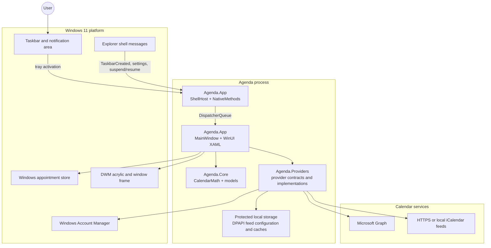
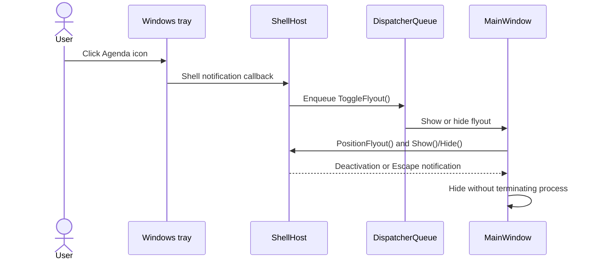
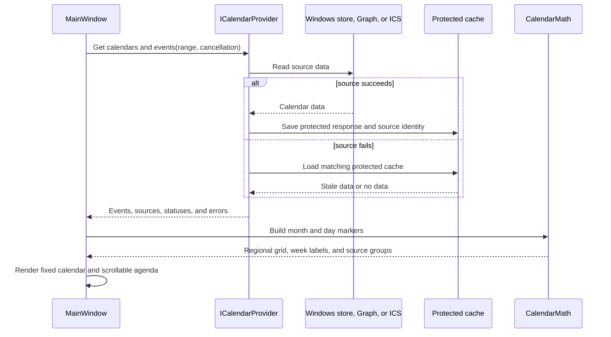
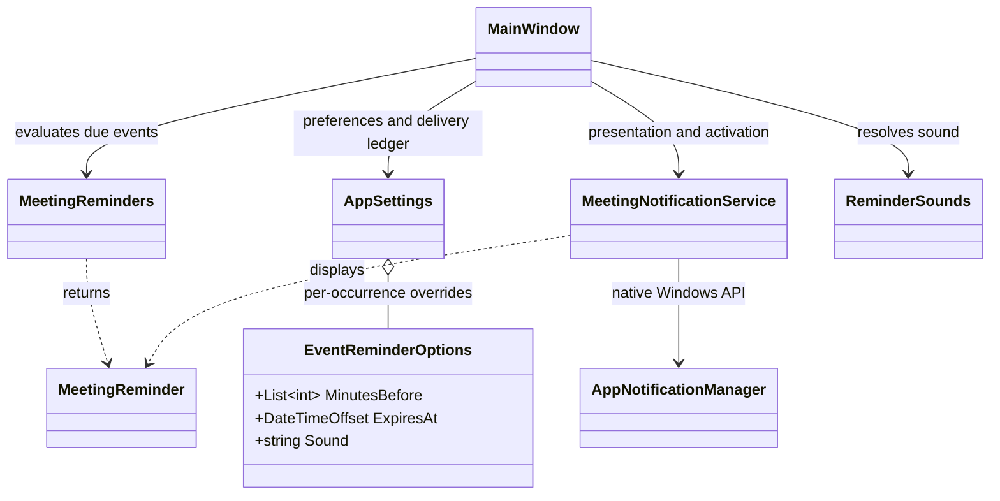
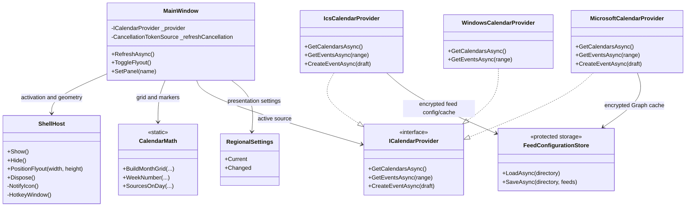

# Agenda architecture

Agenda is a native, unpackaged Windows 11 desktop application. It presents a compact calendar flyout, is activated from the notification area or a global shortcut, and reads calendar data through provider implementations. The design keeps WinUI presentation, Win32 shell integration, calendar rules, and remote data access in separate layers so that each can be tested without requiring a live account.

The editable application version lives in `Directory.Build.props` as `AgendaVersion`. MSBuild emits it as assembly informational, file, and assembly version metadata; `App.Version` reads that compiled value for the Settings page. The package script converts the same three-part value to the four-part MSIX manifest format, and `scripts/check-release.ps1` verifies that a `vX.Y.Z` tag and changelog heading match before release tagging.

## System boundary

The process owns the flyout window and its notification-area icon. Windows owns the taskbar, Explorer, the Windows account broker, and the appointment store. Agenda does not inject UI into Explorer, subclass the taskbar, or capture broad mouse input. Taskbar-clock interception is intentionally disabled; the supported entry points are the Agenda tray icon and `Ctrl+Alt+A`.



The diagram shows ownership rather than deployment. The Windows appointment store and WAM are optional runtime dependencies: the current Settings UI exposes iCalendar feed management, while the Windows-store and Graph implementations remain available in code for future or previously configured source modes.

## Code organization

### `Agenda.Core`

This is the platform-independent domain layer. It contains the shared calendar models and date-only rules used by every provider and by the calendar grid:

- `Models.cs` defines calendar sources, events, drafts, feed configuration, provider state, and regional settings contracts.
- `CalendarMath.cs` builds month grids, applies the selected culture/calendar, calculates week numbers, handles ISO overrides, and determines which feeds contribute a marker to a day.
- `FeedColorPalette.cs` owns the Windows-themed default palette and least-used color selection.
- `CalendarEventMemory.cs` retains the current-month buffer independently of the browsing buffer.
- `MeetingReminders.cs` selects due reminders and builds stable occurrence/delivery identities; `ReminderSounds.cs` defines sound choices and resolves default versus per-event sound preferences.

The core layer does not know about WinUI, HWNDs, HTTP, Graph, DPAPI, or the Windows account broker. Date-only calculations are kept separate from event instants so that changing regional settings does not move an event in time.

### `Agenda.Providers`

Providers convert external calendar systems into the shared core models. They are selected by the application connection coordinator and expose the common provider contracts.

- `IcsCalendarProvider` reads HTTPS or local `.ics` sources. It evaluates recurrence, time zones, exclusions, all-day ranges, redirects, limits, and partial-feed failures. ICS sources are read-only.
- `MicrosoftCalendarProvider` uses MSAL/WAM and Microsoft Graph when a valid public client ID and an account are configured. It supports the Graph calendar and event operations retained for optional future UI exposure.
- `WindowsCalendarProvider` is in `Agenda.App/Services` because it calls the Windows appointment-store API directly. It exposes the calendars that Windows makes available to the app and is read-only.
- `ProtectedCalendarCache` and the feed configuration store persist protected metadata and event text. Feed locations are kept inside the protected cache envelope so an edited source cannot accidentally reuse another source's events.
- `GraphCalendarClient` contains the HTTP-level Graph calls, paging validation, payload mapping, and error translation.

Provider failures are represented as status and error information where possible. A feed that fails can use a matching encrypted cache and is labelled stale; one failed feed does not hide successful feeds. Authentication and consent are never silently prompted during background refresh.

### `Agenda.App`

The application layer owns the WinUI window, presentation state, settings, provider selection, and shell lifetime.

- `App.xaml` and `App.xaml.cs` create the WinUI application and establish the per-user data directory and single-instance behavior.
- `MainWindow.xaml` defines the fixed flyout layout: clock, month grid, week-number column, selected-day heading, scrollable agenda region, settings, and feed dialogs.
- `MainWindow.xaml.cs` coordinates rendering, selection, regional changes, refresh, and panel navigation. Long operations use cancellation and an operation gate so an older refresh cannot overwrite newer state.
- `MainWindow.Connections.cs` loads configured feeds, switches providers, refreshes data, and opens the add/edit feed dialog. Microsoft and Windows-account controls are currently hidden while their implementation remains in the codebase.
- `MainWindow.FeedColors.cs` handles feed color edits, source-marker rendering, and the palette UI without forcing a network refresh for a color-only change.
- `MainWindow.Reminders.cs` owns the reminder timer, default and per-occurrence controls, delivery ledger, and notification activation dispatch.
- `Services/MeetingNotificationService.cs` registers with Windows App SDK app notifications and translates reminders into native notifications, including sound and activation arguments.
- `Services/RegionalSettings.cs` reads Windows culture, first weekday, week rule, time format, and calendar settings, and raises changes when Windows settings change.
- `Shell/` contains the native notification icon, global hotkey, monitor/DPI geometry, DWM frame handling, and shell message window.

The UI is the only layer that directly schedules work on the WinUI dispatcher. Shell callbacks and provider continuations marshal back to that dispatcher before touching controls.

## Main runtime flows

### Activation and dismissal



`ShellHost` handles both modern notification version 4 callbacks and legacy mouse notifications, but does not process both protocols for one activation. During a tray gesture it briefly defers deactivation dismissal, which prevents the normal outside-click path from immediately reopening or closing the flyout. A second click on the tray icon toggles the existing window closed.

The shell host also listens for `TaskbarCreated`, display/settings changes, and suspend/resume. It recreates the icon after Explorer restarts, chooses the light or dark thin-line icon from the system theme, and clamps the flyout to the active monitor work area using effective DPI.

### Calendar refresh and rendering



The month grid is fixed while only the selected-day agenda scrolls. A day marker groups events by visible feed source: one source is a dot and multiple sources are represented by adjacent color segments. Hidden calendars are excluded before markers are calculated.

### Feed editing

Feed management is deliberately read-only with respect to the remote calendar. The add and edit dialog validates the name, source location, and palette color, then encrypts the saved configuration for the current Windows user. Editing a name or color preserves the feed identity; editing the source location invalidates reuse of the old source's cache until the new source refreshes successfully.

## Class relationships

### Meeting reminders

Notifications are opt-in. A ten-second dispatcher timer evaluates loaded events after connection initialization, including while the flyout is hidden. Only visible calendars and timed, unexpired events are eligible. Defaults allow multiple offsets (0, 5, 10, 15, 30, or 60 minutes). Enabling **Use custom reminders** in event details replaces those offsets for that occurrence; an empty custom list disables its reminders. The custom sound can inherit the global choice. The master switch disables every reminder.

`MeetingReminders.Key` hashes source mode, calendar ID, event ID, and UTC start ticks. A delivery key adds the reminder offset, so recurring occurrences and multiple reminders remain distinct. Sound changes do not change delivery identity. Due times have a sixty-second grace window; old reminders are skipped after startup or sleep. The ledger is saved before Windows delivery for at-most-once attempts, so a crash or delivery failure can lose an alert rather than replay it. Expired ledger entries and overrides are pruned after a day.

```mermaid
sequenceDiagram
    participant Timer as MainWindow reminder timer
    participant Core as MeetingReminders
    participant Settings as AppSettings
    participant Service as MeetingNotificationService
    participant Windows as Windows notifications
    Timer->>Core: Due(events, visible calendars, defaults, overrides, ledger)
    Core-->>Timer: Due occurrence/offset pairs
    loop Each due reminder
        Timer->>Settings: Persist delivery key before sending
        Timer->>Service: Show(event, time, calendar, resolved sound)
        Service->>Windows: AppNotificationManager.Show(notification)
    end
    Windows-->>Service: NotificationInvoked(event digest)
    Service->>Timer: Dispatch activation to UI thread
    Timer->>Timer: Await connections; open source event or details
```

Windows owns banners, Notification Center, audio policy, and Do Not Disturb. Built-in sounds use `SetAudioEvent`; Silent uses `MuteAudio` and still displays the notification. The service registers its activation handler before calling `Register`, and unregisters on exit. Activation looks up the digest among loaded events; if the event is unavailable, the flyout reports that instead. No future notifications are scheduled in Windows, so reminders require Agenda to remain running. Disabling notifications clears notification history; editing an occurrence clears its notification group.



### Calendar and shell components



`CreateEventAsync` is part of the shared contract for the optional Graph provider. The ICS provider rejects writes as read-only, and the Windows appointment-store provider currently exposes read-only data. The UI hides non-ICS management controls until those workflows are intentionally re-enabled.

## State and concurrency

The application has three independent kinds of state:

1. **Presentation state** — selected date, month, collapsed/expanded state, active panel, visible calendars, regional settings, and scroll position. This is held by `MainWindow` and rebuilt when system settings change.
2. **Connection state** — the active provider, configured feed list, refresh timestamps, per-feed status, and cancellation handles. Provider replacement occurs only after new configuration validates and saves successfully.
3. **Persistent state** — files under `%LOCALAPPDATA%\\Agenda` (or the explicit development data directory). Feed locations and event caches use DPAPI `CurrentUser` protection. `AppSettings` is plain JSON saved through a temporary file and atomic replacement; it contains presentation preferences, reminder defaults, occurrence overrides, and the delivery ledger. Reminder keys contain hashes rather than event titles, raw calendar IDs, or subscription URLs.

Refreshes are cancellable and serialized by an operation gate. A refresh captures the requested date range and regional time zone, so a result for an older range or provider cannot replace a newer selection. Dialog saves use a deferral and validation before committing changes; cancellation clears the draft.

## Security and privacy boundaries

- Secret ICS URLs and cached event text are encrypted with Windows user protection and are never intended for source control.
- Network feeds require HTTPS, enforce response and recurrence limits, and follow only HTTPS redirects.
- Status messages sanitize private URLs and raw transport errors.
- Graph uses a public client ID and delegated consent through WAM; no client secret is embedded or required.
- Feed connections are read-only. Anyone who obtains a secret Google or published Outlook ICS link can read that feed, so users must treat links as credentials and rotate them at the provider if exposed.
- The repository ignores local profiles, build output, package files, and signing certificates. MSIX output is a local packaging artifact and is not published from this repository.

## Packaging and deployment

The normal development build is an unpackaged WinUI 3 executable. `scripts/build.ps1` restores and builds x64 or ARM64. `scripts/package.ps1` publishes a self-contained portable directory and creates an MSI by default; MSIX requires `-Format Msix`. Both formats are unsigned unless an existing signing certificate is explicitly selected by thumbprint or PFX. Certificate creation and trust are separate commands; packaging never creates keys or installs trust.

All reusable packaging mechanisms come from the Git submodule at `external/winbuildtools`: installer creation/inspection, certificate validation and signing, SDK discovery, tool logging and final hash/signature metadata. Checkout initialization belongs to the developer/CI checkout, not the build. `scripts/packaging/Agenda.ps1` is the only local product adapter. It fails before publishing if the checkout is missing, passes Agenda's MSI JSON to the shared engine, or generates Agenda's MSIX manifest outside the portable payload. The generated XML preserves Agenda's capabilities/extensions while applying the selected version, architecture and publisher.

Agenda retains its custom publish context, dependency auditing, license collection, resource checks, signing choices and product/release fields. Signing and generic final metadata generation are executed by shared helpers; the local adapter adds Format/Architecture and the legacy Commit alias without calculating hashes or inferring signature success. The external MSIX stage/unsigned package and inspection evidence remain under the isolated build's installer directory; an Agenda-named copy is finalized at the build root. Local signing/certificate/SDK/logging/hash implementations are removed. Development key creation and administrative trust use the separate shared commands directly. Builds do not install products, register startup or publish to the Store. `deployment/Assets` contains source artwork and tray icons used by both unpackaged and packaged output.

## Test seams

`scripts/run.ps1` invokes the incremental build before launching, so missing or stale outputs are rebuilt and build errors prevent launch. Self-contained builds import `deployment/NotificationRuntime.targets`, which extracts `Microsoft.WindowsAppRuntime.Insights.Resource.dll` from the matching NuGet runtime MSIX. This works around Windows App SDK 2.4 notification registration error `0x8007007E`; the package script verifies that the DLL reaches the publish output. The MSIX manifest declares matching toast-activation and COM-server entries for packaged activation. Optional `--notification-diagnostics` logging records registration status, accepted notification IDs, and activation without event payloads.

The repository uses small executable test projects rather than a test framework:

- `tests/Agenda.Tests` exercises regional date math, week-year boundaries, event overlap, feed-color grouping, memory buffers, reminder timing and deduplication, and sound inheritance and persistence compatibility.
- `tests/Agenda.ProviderTests` uses deterministic fixtures and mocked transport/authentication for Graph, ICS parsing, recurrence, limits, protected caches, and failure behavior.
- `tests/Agenda.ShellTests` links the shell sources directly and checks geometry, strict clock-target validation, tray lifecycle, notification callback de-duplication, and native smoke behavior.

The GitHub Actions workflow is manual-only. It initializes recursive submodules, runs pinned tool and Agenda verification, and builds/inspects MSI/MSIX for x64 and ARM64 on Windows. Live account consent, remote feed freshness, multiple-monitor variations, signed installation, and native ARM64 execution remain environment-dependent manual checks.

## Extension points

New calendar sources should implement `ICalendarProvider` and map into the existing `CalendarSource`, `CalendarEvent`, and provider-status models. They should keep authentication and transport details inside the provider, use cancellation, expose truthful read/write capabilities, and protect any cache with a source identity. UI changes should consume those contracts through `MainWindow.Connections.cs` rather than calling remote APIs from XAML event handlers.
