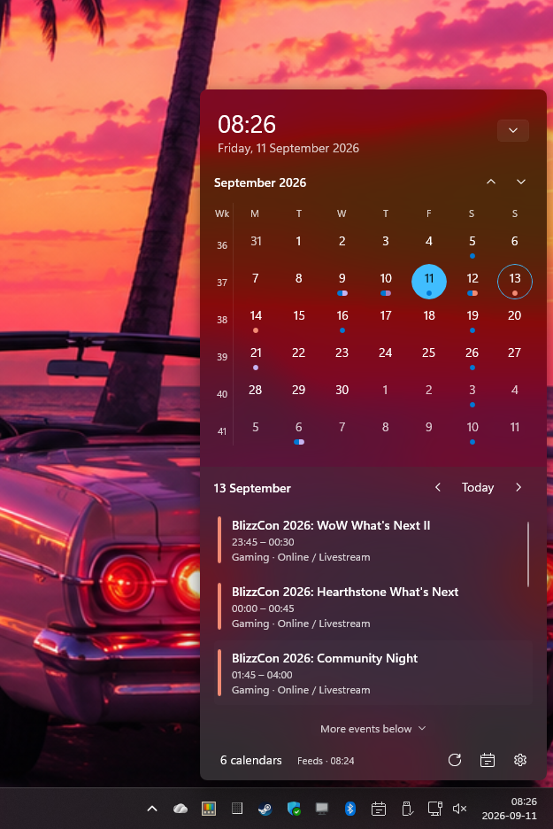

# Agenda

Agenda is a native Windows 11 calendar flyout for the notification area. It gives you a quick monthly calendar and a focused agenda without opening a full calendar application. The interface follows Windows 11 typography, spacing, colors, acrylic surfaces, and system regional settings.

<p align="center">
  
</p>

## What you can do

- Open and close the flyout from the Agenda notification-area icon or with **Ctrl+Alt+A**.
- Browse months, select a day, and move between nearby days with the compact calendar controls.
- See week numbers using Windows regional rules or switch to ISO 8601 numbering.
- See which calendars have events on each day through colored dots and segmented color pills.
- Review the selected day's agenda in a scrollable event list, including an indicator when more events are below.
- Click an event to open its specific source-calendar link. When a source does not provide a deep link, Agenda shows the event details in the flyout.
- Keep the current month and nearby months cached so returning to them is fast, including while offline.

## Install and open Agenda

Download the package for your Windows architecture from the repository's [Releases](https://github.com/kiforsbe/agenda/releases) page and install it. A package signed with a development certificate requires that certificate to be trusted on the computer before Windows will install it; public releases should use a trusted publisher certificate or the Microsoft Store.

After Agenda starts, its icon appears in the notification area. If Windows puts it in the hidden overflow menu, open that menu to find it. Left-click the icon to toggle the flyout. Right-click it for **Open**, **Settings**, and **Exit**. Agenda keeps one instance per Windows session.

## Use the calendar

1. Open Agenda from the tray icon or press **Ctrl+Alt+A**.
2. Use the previous and next month buttons, or scroll while the pointer is over the calendar grid, to change the visible month. The current month remains available in memory.
3. Select a date to show its agenda. Use the arrows beside **Today** to move one day at a time, or choose **Today** to return to the current date.
4. Scroll the agenda list to see every event. **More events below** appears when the list has additional entries.
5. Select an event to open its source calendar at that event. If the source does not expose a link, the flyout opens a detailed event view instead.

The calendar uses the first weekday, date formats, time formats, calendar system, and week rule from Windows regional settings. Turn on **Use ISO week numbering** in Settings when you need Monday-based ISO week-years instead.

## Add and manage calendar feeds

Agenda currently exposes read-only iCalendar feeds in its user interface. This works with personal Google Calendar secret iCal links, Outlook.com published ICS links, and local `.ics` files without a business account, Entra application, or Google developer registration.

1. Open the flyout and click the calendar icon beside the bottom **Settings** button.
2. Choose **Add calendar feed**. The small dialog collects a name, an ICS URL or local file path, and an optional calendar website used as a fallback when an event has no direct link.
3. Choose a color or keep the suggested Windows-friendly palette color, then select **Add**.
4. Drag a feed row to reorder it. Clicking the pencil edits its name, source, website, or color; the trash icon removes it. Click a color swatch to change only the color.
5. Use **Refresh** in the footer to fetch the latest entries. Feeds also refresh automatically while Agenda is running.

Feeds are read-only: create and edit events in the service that owns the calendar. Treat secret ICS URLs like passwords because anyone who has a link may be able to read the calendar. Agenda encrypts saved feed links for the current Windows user and keeps encrypted event caches for offline use.

## Settings and current limitations

Enable **Meeting notifications** in Settings to receive native Windows notifications while Agenda runs in the tray. Under **Reminder times**, select any combination of at start, 5, 10, 15, 30 minutes, or 1 hour before. Choose a **Notification sound**: Windows default, Reminder, Mail, Instant message, Text message, or Silent. Silent keeps the notification visible without playing audio. Reminders are off by default and apply only to timed events in visible calendars. Windows notification settings and Do Not Disturb still apply.

Right-click an event (or press **Shift+F10** while it is focused) and choose **Event details and reminders**. Turn on **Use custom reminders**, then open **Reminder times** beside the toggle to select custom times for that occurrence. Choose its notification sound or leave **Use default sound** selected to follow Settings. Clear all custom times to disable notifications for the occurrence. Changes save immediately, and the main Settings toggle disables all reminders, including overrides. All-day events are excluded. Missed reminders more than a minute old are skipped after startup or sleep; each occurrence/time combination is delivered at most once.

Settings contains week-number controls and the active Windows regional week-rule summary. Windows appointment-store and Microsoft sign-in management remain implemented in the codebase but are hidden from the current UI; saved feed sources are the supported setup path in this release.

The taskbar clock is not intercepted. Windows continues to own clicks on its clock; use the Agenda tray icon or **Ctrl+Alt+A** instead. See [taskbar integration notes](docs/taskbar-integration.md) for the retained experimental implementation.

## For contributors

Agenda is built with C#, WinUI 3, and Windows App SDK. The component boundaries, runtime flows, protected-data model, and Mermaid diagrams are documented in [ARCHITECTURE.md](ARCHITECTURE.md). The user-visible release history is in [CHANGELOG.md](CHANGELOG.md).

### Build and run

Requirements: Windows 11, .NET 10 SDK, and Windows SDK 10.0.26100.0. The Windows App SDK is restored from NuGet; the flyout does not use a browser rendering engine.

```powershell
./scripts/build.ps1
./scripts/run.ps1
./scripts/test.ps1
```

`run.ps1` automatically restores dependencies and runs an incremental build before launching. MSBuild rebuilds missing or out-of-date outputs; a failed build stops the launch. Use `-Configuration Release` for a Release build (the default is Debug).

For an isolated development profile:

```powershell
./scripts/run.ps1 -DataDirectory ./work/profile
```

### Versioning and releases

The editable version is `AgendaVersion` in [Directory.Build.props](Directory.Build.props). It is compiled into the app and displayed in Settings; packaging derives the four-part MSIX version from the same value. Before creating a tag, update `AgendaVersion`, add or update the matching `## [major.minor.patch]` entry in [CHANGELOG.md](CHANGELOG.md), and run:

```powershell
./scripts/check-release.ps1 -Tag v0.2.0
git tag v0.2.0
```

The check fails when the tag, project version, or changelog heading does not match. Replace `0.2.0` with the new version in both the command and the files.

### Packaging and signing

Self-contained builds include the notification runtime resource from the matching NuGet runtime package through [NotificationRuntime.targets](deployment/NotificationRuntime.targets). This works around the missing-resource registration failure tracked in [Windows App SDK #6071](https://github.com/microsoft/WindowsAppSDK/issues/6071); the package script checks that the DLL reaches the publish output.

```powershell
./scripts/package.ps1 -Architecture x64
./scripts/package.ps1 -Architecture ARM64
```

The script creates a self-contained portable directory and a **signed** MSIX in `artifacts/`. By default it uses a temporary self-signed development certificate and removes its private key afterward. To reuse the persistent certificate in the current user's Personal certificate store (`Cert:\CurrentUser\My`), pass `-UseCertificateStore`; it creates the certificate if needed and exports only its public certificate to `artifacts/signing/`. Trust that certificate once per computer from an administrator PowerShell before installing:

```powershell
./scripts/package.ps1 -Architecture x64 -UseCertificateStore
./scripts/trust-dev-certificate.ps1
Add-AppxPackage ./artifacts/Agenda-x64.msix
```

To create or inspect the persistent development certificate without packaging, run `./scripts/setup-dev-certificate.ps1`. For distribution, pass a publisher-matching PFX with `-CertificatePath` and, when needed, `-CertificatePassword`.

A self-signed certificate is suitable for development, testing, or managed devices where an administrator deploys the certificate. It cannot make a direct GitHub download installable for every Windows user because each target device must explicitly trust that certificate. Public distribution should use the Microsoft Store or a CA-trusted/Azure Artifact Signing certificate. Never commit a private key.

### Provider and data notes

The provider layer keeps a rolling five-month browsing buffer plus a separate buffer pinned around the actual current month. Manual and five-minute refreshes update both buffers; existing provider disk caches remain encrypted. Offline caches are tied to their source link or file path, so editing a source cannot reuse another calendar's events.

The retained Microsoft Graph integration uses Windows Account Manager and requires a registered client ID when enabled in a future build. End users of a properly configured release do not need Azure accounts or app registrations. See [Microsoft account setup](docs/microsoft-account-setup.md) for the developer flow. Google account OAuth is not implemented; personal Google calendars use secret iCal links.

User settings and caches are under `%LOCALAPPDATA%/Agenda` unless `--data-dir` is supplied. Disconnecting a provider clears its active cache; configured feed links remain until removed from the feed screen. See [validation](docs/validation.md) for the checks that have been run and the remaining real-account validation.

### Public distribution

Store or certificate publishing remains a separate step; the scripts do not register startup, install the package automatically, or publish to the Store. Use `-Publisher` to set the intended certificate subject; Store publishing requires the identity assigned by Partner Center.

This repository does not yet include a software license. Add one before accepting third-party contributions or distributing the code.
